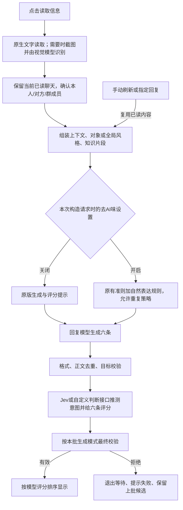

# V1.5.2 开启与关闭去AI味：工作原理和审查

审查日期：2026-10-23。应用代码基线：6f80e8b，V1.5.2 / versionCode44。本轮仅审查和执行验证，没有修改业务代码、规则、版本或安装包，也没有请求真实聊天模型。范围是开关所涉及的完整工作链，不是对所有手机兼容性及全部软件功能的无限范围证明。

## 主链

这是微信/QQ/抖音面板的主要路径。代码入口是ChatCaptureService.captureNow/accept、AppGraph.inputFor/generate、AutomaticAdvisor.generate、JevJudgeClient.rank、BatchCoordinator.completeResult和AdvisorController发布状态。开关没有进入截图、OCR、昵称读取、输入框定位或填入链。

## 两种状态的差异

| 项目 | 关闭 | 开启 |
|---|---|---|
| 模型 | 使用已配置的回复、视觉、判断接口 | 使用同一份配置，不切换服务、模型或本地推理引擎 |
| 聊天识别与已读上下文 | 原有读取与存储机制 | 完全共用，不为开关重新截图、识别或读取 |
| 知识 | 同一46份索引资料与检索逻辑 | 同一知识；额外规则在请求中提供，不新增知识检索库 |
| 原有质量准则 | 保留具体回应、互惠、幽默、边界等V1.5.0准则 | 保留这些准则，再加入自然表达要求 |
| 单聊策略 | 六条须六种不同策略标签 | 策略标签允许重复，正文仍须不同 |
| 群聊策略 | 原本就允许重复策略标签 | 继续允许；仍区分成员和话题 |
| 面板长度提示 | 默认建议15–45字；详细风格可延长 | 按信息量表达，几个字能答清就不扩写；必要解释可完整表达 |
| 硬长度限制 | 正文1–300字 | 相同 |
| 评分 | 原版共用准则 | 增加自然表达提示，短答、长句、俏皮话、问句或不同标签都不自动加分 |
| 最终显示校验 | 按本批关闭模式校验 | 按本批开启模式校验；V1.5.2已修复此处漏传模式 |

注意：15–45字是提示词指导，不是关闭模式的硬性最小字数；短于15字并不因此单独触发拒绝。开启后放宽的是“策略标签必须六种”的硬限制，不是取消正文去重、六条数量、目标和长度检查。

## 开启时加入的实际规则

NaturalReplyPolicy.kt把参考资料归纳为6组指导，而不是把用户图片的100条全部照搬：
1. 按实际平台、关系和场景表达；只参考已读ME消息中的口吻样本，没有样本就平实表达。
2. 不凑字数，不强迫六条一样长、一样整齐。
3. 只沿用有依据的细节，不编造经历、习惯、天气、物品或“亲测”。
4. 按本人习惯选用语气词、表情、口语停顿和调侃，不固定加“哈哈”“其实啊”，不故意错字。
5. 日常少用报告、客服、鸡汤措辞；正式或严肃场景保留必要事实、术语、否定和承诺范围。
6. 问句、幽默、邀约按需出现，也可直接回答或自然结束。

这些规则随原有请求传给回复与评分模型，没有额外的“生成后再润色一次”接口。Humanizer-zh只是参考的规则来源，没有在手机执行该skill，也没有自动训练用户口吻模型。

专属对象风格优先；没有专属风格时用对应单聊/群聊全局风格。明确风格可以控制语气、长度、标点，但不能覆盖事实、拒绝边界、目标归属或硬格式限制。以上主要由提示词引导，程序没有本地逐字保证“无AI味”或全部风格都正确执行。

## 保存、切换、刷新

- 这是单个全局布尔设置，不是每个对象独立的开关；默认false。设置页和面板菜单共用AppSettings，附件期间观察已保存值，移除时注销监听；写入失败恢复实际状态。
- 开关存在filesDir下的AES-GCM加密设置。应用清缓存仅清cacheDir等缓存目录，不删除这份设置；清除软件数据会重置。
- 切换只保存设置，不读取聊天、不自动请求模型、不重写已有候选。
- 实际取值时刻是AdvisorController后台任务调用inputFor组装请求时，不是按钮按下的一瞬间。组装后AdvisorInput是不可变值；同一次生成、评分和最终校验沿用该模式，后续再切换不会中途改变这批规则。
- 刷新从conversation.current取得上次已读快照，保留指定目标，并取新设置生成；不重新调用视觉读取，也不会凭空获得后来出现但未手动读取的消息。
- 刷新带上最近3批共最多18条旧候选以引导避重；程序会拒绝整批全是旧正文的结果，部分与旧候选重合不一定触发整批拒绝。

## 模型与调用次数

微信/QQ/抖音面板普通成功路径：1次回复生成+1次判断/评分。原生内容不足或有媒体需要识别时，前面另有视觉请求；开关不决定是否视觉识别。格式不合格时，生成阶段最多再请求1次修复；不是无限重试，判断失败也没有追加润色请求。

固定判断接口使用代码默认typesafe/jev-1.13，7个基础问题加6个候选评分，一次请求13题。自定义判断走其所选兼容接口。程序校验评分范围后按模型分数排序，没有用本地启发式假冒模型评分。Jev分数是适合程度，不是对方回复、接受或恋爱成功的概率。

开启状态增加提示文字，所以不能承诺费用、时延、总token完全不变；可以确认没有因开关新增一个独立的模型调用步骤。

## 其他页面与分支

- **逐句判断分析：** MessageAnalysisController→JevJudgeClient.inspect没有去AI味参数。缓存按会话、目标消息和判断配置区分。打开判断页面后按可见消息依次分析，已有缓存则复用。开关不使它自动重新判断。面板顶部随候选排序返回的摘要则使用rank输入，开启后的输入提示不同，不能保证两种状态的摘要输出逐字相同或开启后更准。
- **指定回复：** 六条都指向所选OTHER原话；其余已读消息作为上下文，后续称呼或本人发言不替换指定目标。两种模式共用此规则。
- **完整咨询：** 首次可以先用Jev做前置判断，再由UnifiedAdvisor统一生成分析和六条完整候选；已存在共同分析时刷新复用它。自然规则进入UnifiedPrompt，候选同样保存生成模式。它不是面板的逐条Jev排序路径。
- **建议：** 面板首次展开一条未缓存的建议，另发1次回复模型请求；缓存后再次展开不重发。完整咨询通常已随六条返回理由和后续分支，可直接本地展开。这里存在BUG-002：面板建议采用当前设置而非对应候选批次的模式。
- **复制/填入：** 对当前选中的候选正文操作，不因开关额外改写，不自动发送。

## 相同的硬检查与边界

两种模式都要求六条、有效策略枚举、非空且不同ID、正文1–300字、规范化后正文不重复、有效评分范围和等级。群聊/指定回复校验已读OTHER目标，不能把本人发言冒充对方。模型返回的naturalRepliesEnabled字段不能改变实际请求模式。

真正的语义重复、自然程度、幽默是否得体和用户风格是否充分遵守仍主要依赖模型。评分低的候选不会仅因分低自动触发一次润色。已读上下文也有限制：面板单聊最近50条；群聊按50/100/200配置；单条文字、背景和知识片段各有截断上限。“参考已读内容”不等于无限读取全部微信历史。

## 审查发现

BUG-001（Intermediate）：读取间隔超时不等于整次分析总时限；持续慢响应可长期等待，两个状态都受影响。

BUG-002（Normal）：同批旧候选首次查看建议时可能使用新开关规则；已缓存建议仍保留旧内容，生效边界应统一或明确说明。

具体位置、触发条件、复现和建议处理方式见仓库根目录bugs.md。本轮没有修复这些问题，也没有改动生成规则。

## 验证与范围

- 本轮重跑核心459项、设置18项，全部通过。覆盖开关迁移、关闭原版校验、生成/排序到最终显示、ON/OFF切换刷新、单聊/群聊/指定目标、模式不能由模型JSON伪造、无效结果可重试及过期结果隔离。
- 本轮重跑24份OFF请求与V1.5.0基线的逐字节比较，通过。范围为固定测试输入中的面板生成、固定/自定义评分、完整咨询和建议；不是对所有真实对话输出一致的承诺。
- 本地回环HTTP探针：readTimeout=250ms，持续50ms一次的数据响应总耗时1330ms仍成功；完全静默的响应258ms超时。证明应用没有总截止时间，未请求外部模型、未发送聊天或密钥。
- 这不是连接手机后的实测，也没有进行真实模型自然度或判断准确率的A/B评测。不能以自动化测试通过代替所有设备、网络和真实对话的验收。
- 源码审查覆盖设置保存/订阅、模式传递、生成/提示词/解析/校验、两类判断协议、结果发布/失败/过期、刷新/建议/可见消息判断、HTTP取消与关闭、加密设置与缓存隔离、知识来源及软硬规则一致性；未把无关的系统级填入兼容性、所有OEM无障碍行为或旧版本安装器问题宣称为本轮已验证。
